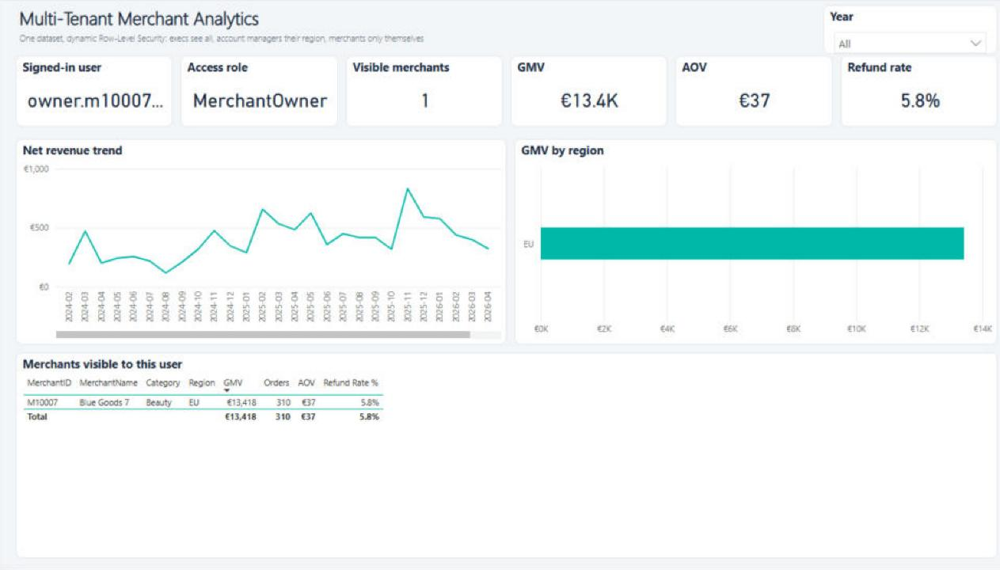
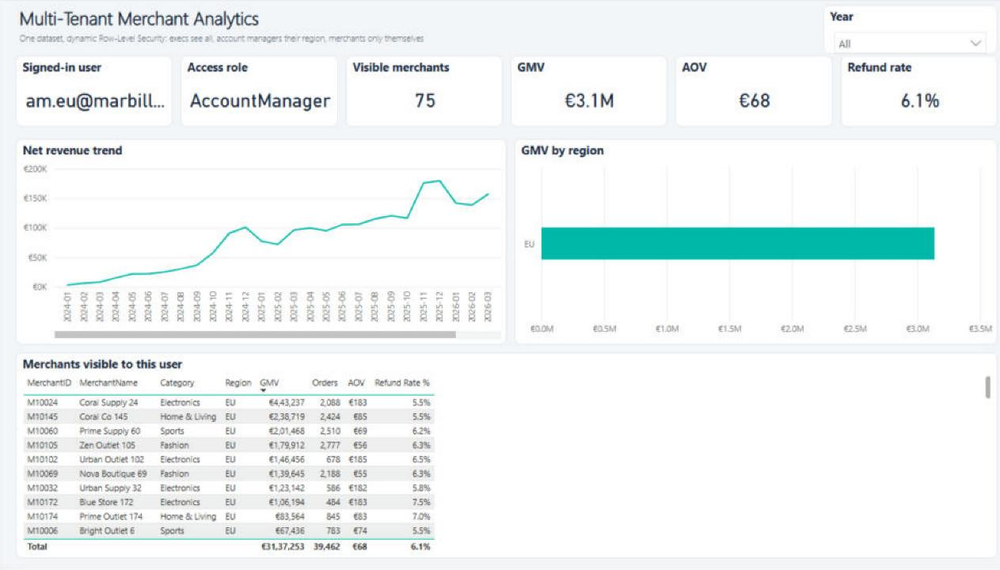
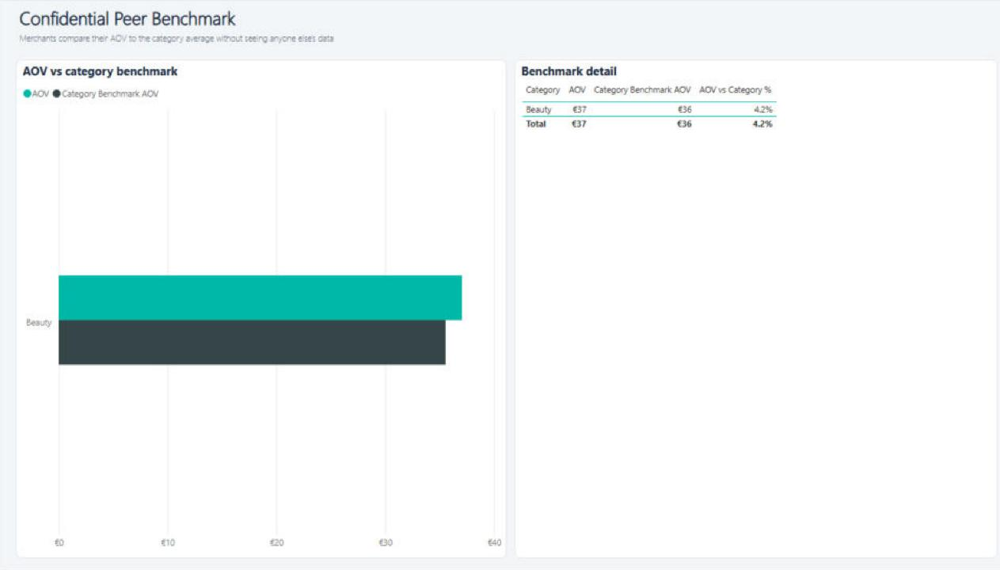

# Multi-Tenant Merchant Analytics with Dynamic Row-Level Security — Power BI

One report, one dataset, many audiences. Executives see the whole platform, regional account managers see their region, and each merchant sees **only their own store** — enforced by dynamic RLS driven by a security mapping table, not by copying reports.

| Viewed as a merchant owner (1 merchant) | Viewed as the EU account manager (75 merchants) |
|---|---|
|  |  |

## Why this matters
SaaS platforms that serve thousands of merchants can't maintain a report per customer. Dynamic RLS keeps tenant data isolated while the BI team maintains a single model.

## How the security works
| Viewer | Role in `security_user_access` | Sees |
|---|---|---|
| `cfo@…` | Executive | All 180 merchants |
| `am.eu@…` | AccountManager, Region = EU | EU merchants only |
| `owner.m10007@…` | MerchantOwner, MerchantID = M10007 | One merchant |
| anyone else | — | Nothing |

The role filters the small `dim_merchant` table with `USERPRINCIPALNAME()`; the filter flows to the fact table through a single-direction relationship. A **category benchmark** lets merchants compare their AOV with peers without exposing anyone else's rows (pre-aggregated calculated table, no relationship to the secured dimension).

## What's inside
| Folder | Contents |
|---|---|
| `data/` | Merchants, orders, and the `security_user_access` mapping table |
| `dax/rls_and_measures.dax` | RLS role expression, viewer-role measures, KPI measures, confidential category benchmark |
| `docs/governance.md` | Dev/Test/Prod deployment pipeline, workspace & App access, incremental refresh, performance checklist |
| `Multitenant-Merchant-RLS.pbix` | The Power BI report with the `Dynamic Tenant` role |
| `*.Report/`, `*.SemanticModel/`, `.pbip` | Power BI Project (PBIR + TMDL); the RLS role lives in `definition/roles/Dynamic Tenant.tmdl` |

## Report pages
1. **Merchant Performance** — GMV, net revenue, orders, AOV, refund rate; header shows who is viewing and their role.
2. **Peer Benchmark** — merchant AOV vs category average.
Screenshots above were taken with Power BI Desktop's *View as* — same report, same dataset, different user.

## Skills demonstrated
Row-Level Security (dynamic, multi-role) · Power BI Service governance · deployment pipelines · incremental refresh · data modelling for multi-tenant SaaS · DAX

## How to test
Open the `.pbix` → *Modeling → View as → Other user* → enter one of the emails above and tick **Dynamic Tenant**.

*Data is synthetic and generated with Python for portfolio purposes.*
